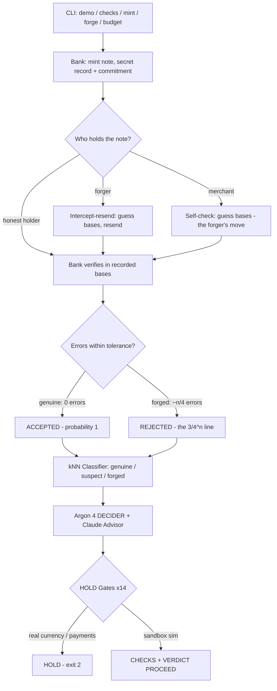
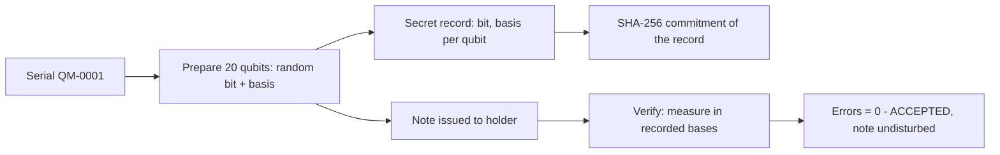
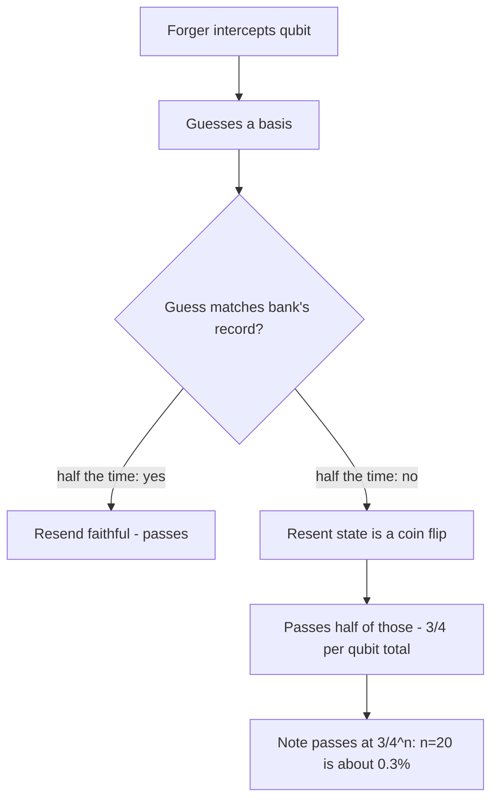
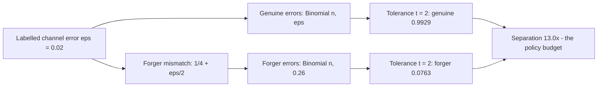
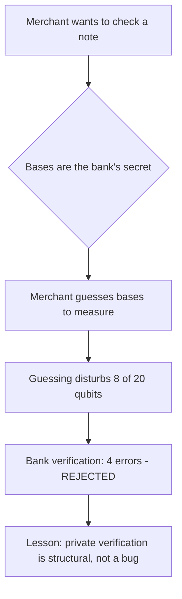
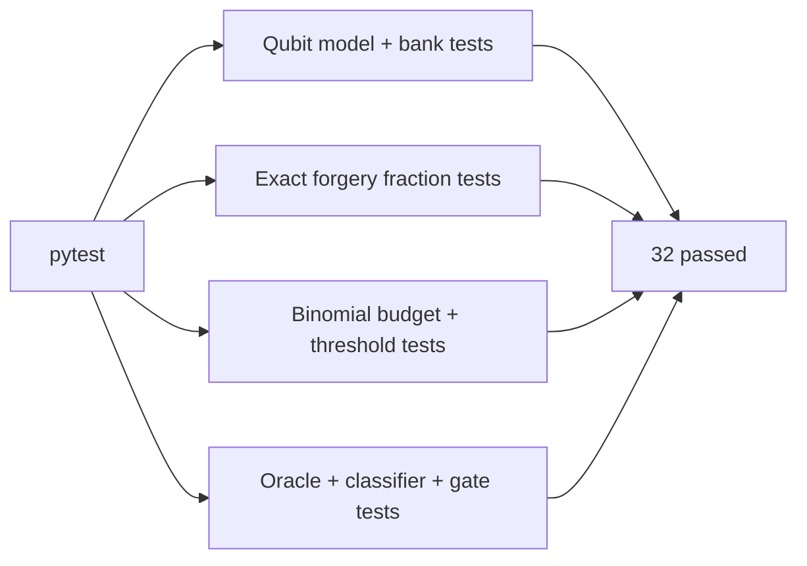
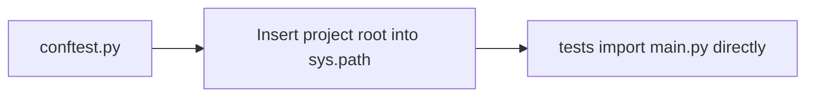
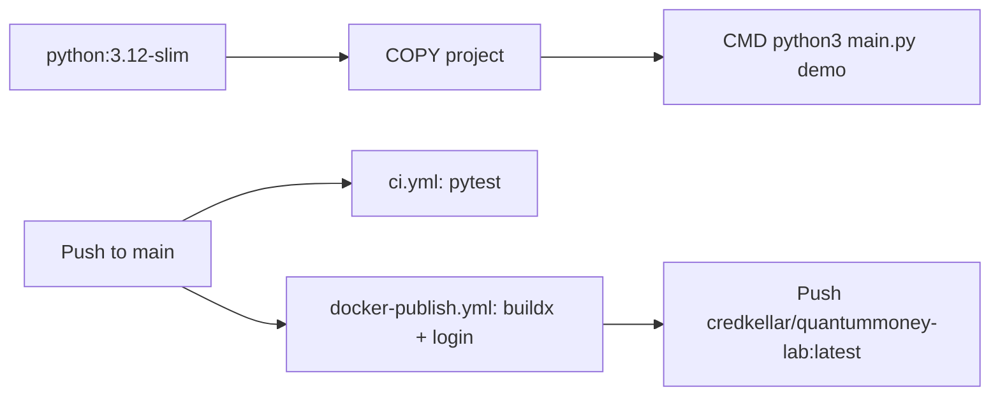

# QuantumMoney-Lab 💵⚛️

**Wiesner Quantum Money Lab** — by Darion Kellar

QuantumMoney-Lab is an **educational quantum money lab** in ONE pure-Python file. It builds **Wiesner's quantum money scheme** end-to-end: a bank prepares **20 qubits in secret random bases**, records each `(bit, basis)` pair against a serial number, and issues the note. Verification measures every qubit **in the recorded basis**, so a genuine note passes with **probability 1**. Copying the note is the attack — and the attack is a runnable mode: a forger must **measure** the note to copy it, half the forger's basis guesses are wrong, and each wrong guess turns the resent qubit into a coin flip. A counterfeit qubit passes with probability **exactly 3/4**, a counterfeit note with **(3/4)^n** — computed here in exact fraction arithmetic, then tracked by a seeded simulation.

The honest scope is the whole point, and it is stated everywhere:

- ✅ **What is real:** the protocol logic and its arithmetic. The 3/4 is *derived* in the code (`1/2 · 1 + 1/2 · 1/2`), the (3/4)^n table is exact fractions, the error budget is two exact binomial sums, and the scheme's structural flaw — only the bank can verify — is demonstrated, not footnoted: a merchant's self-check **damages a genuine note** (8 of 20 qubits disturbed, bank verification then fails it).
- 🚫 **What is not real:** the money, the photons, and any security proof. A "qubit" here is a classical `(bit, basis)` pair and measurement is a rule. This lab issues nothing, authenticates nothing, and its toy math must never be presented as a security proof for any real scheme — that overclaim is itself a HOLD gate.

Every real-currency, banking, payment, token, counterfeiting, and unforgeability claim sits behind a permanent HOLD gate (14 total). 🔒

[](https://github.com/kimanicollier44-cmyk/QuantumMoney-Lab/actions/workflows/ci.yml)
[](https://github.com/kimanicollier44-cmyk/QuantumMoney-Lab/actions/workflows/docker-publish.yml)

> ℹ️ These are the **live** workflow badges for this repo. They activate as soon as the `ci.yml` and `docker-publish.yml` files from the paste pack are pasted into `.github/workflows/` — until then they have nothing to report yet.

## 🧰 Tech Stack Badges & Full Architecture Tech Stack

### 💻 Core Programming Languages & Core Systems


- 🐍 Python 3.12, pure standard library (`fractions`, `hashlib`, `json`, `math`, `random`, `sys`) — zero dependencies, zero network, deterministic (seeded runs, double-run byte-identical)
- ⚛️ Classical measurement model stated in the open: a qubit is a `(bit, basis)` pair; measuring in the wrong basis returns a coin flip and replaces the state — the disturbance no forger or merchant can avoid
- 🧮 Exact arithmetic first: the forger's 3/4 is a `Fraction`, the (3/4)^n table is fractions, and both sides of the error budget are exact binomial CDF sums — floats appear only as readouts
- 🧠 TinyML kNN note classifier (from scratch, stdlib): genuine / suspect / forged from (error count, note size, channel error), labels generated by the lab's own verdict policy
- 🪑 Council seats: Gemini Argon 4 DECIDER (names-only, tighten-only) + Muse advisor (never overrides HOLD) + Google Flow plan-only (rendered = False, live = 0)

### ⛓️ Web3 & Infrastructure

- 🚫 **Not applicable — honestly.** No blockchain, no Web3, no tokens — a HOLD gate (`cryptocurrency_token_claim`) forbids exactly that reading. The "infrastructure" in this lab is a labelled simulation of a bank's secret record, a verification desk, and a forger inside one offline file. No fake badges here.

### ⚙️ Platform Support & Hardware Architecture


- 🖥️ Pure Python — runs anywhere Python 3.12+ runs (Linux, macOS, Windows), plus the `python:3.12-slim` Docker image
- 🔒 No hardware is controlled, ever: real quantum memories, photon sources, secure printing, and bank systems are permanent HOLD gates (see the gate table below)

### ⚡ Low-Level Infrastructure & Performance

- 🚫 **No low-level code — honestly.** No C, no C++, no GPU, no compiled extensions: this is one interpreted Python file on purpose, so every mint, measurement, and binomial sum can be read, checked, and diffed. Performance here means honest algorithms — exact `Fraction` exponentiation for (3/4)^n and closed binomial sums instead of Monte-Carlo hand-waving.

### 🛠️ DevOps & Build Tools


- 🐳 Docker (`python:3.12-slim`), GitHub Actions CI + Docker Publish (delivered in the paste pack)
- 🎯 Target image: `credkellar/quantummoney-lab:latest`
- 🧪 Tests: `pytest` (32 tests) + the built-in CHECKS suite (55 checks) in `main.py`

### ☁️ Cloud Providers

- 🚫 **None — honestly.** No cloud provider is used or needed: the lab runs fully offline on your own machine or in a local Docker container. Docker Hub appears only as the registry the publish workflow pushes the image to.

## What this does?

1. 🏦 **The bank mints** — for serial `QM-0001` the bank prepares 20 qubits, each a random bit in a random basis (`+` rectilinear, `×` diagonal), and files the `(bit, basis)` record in its secret book. The record is committed to with SHA-256, so the bank's own book is auditable: quietly editing it changes the commitment.
2. 🔍 **Verification** — the bank measures each presented qubit **in its recorded basis**. Matching-basis measurement is faithful and non-disturbing, so a genuine note passes with **probability 1** — in the seeded run, **200 of 200** genuine notes are accepted, and the same note can be verified twice.
3. 🕵️ **Forgery, intercept-resend** — the forger measures every qubit in a guessed basis and resends the outcomes. Right guess (prob 1/2): the resend is faithful. Wrong guess (prob 1/2): the resent state is a coin flip against the record. The demo forgery of QM-0001 comes back with **6 errors → REJECTED**.
4. 🧮 **The exact (3/4)^n line** — per qubit, `1/2 · 1 + 1/2 · 1/2 = 3/4`, derived in code as a `Fraction`. Note acceptance is then exact: n = 4 → **81/256 ≈ 0.3164**, n = 8 → **6561/65536 ≈ 0.1001**, n = 16 → **0.01002**, n = 32 → **0.00010**, n = 64 → **≈ 1.0 × 10⁻⁸**. Every extra qubit multiplies the forger by 3/4.
5. 🎲 **Seeded simulation, tracked against the math** — over 20,000 forged qubits the measured pass rate is **0.7469** (exact 0.7500); over 4,000 forged 8-qubit notes the acceptance is **0.1010** (exact 0.1001). The simulation is a witness, not the source: the fractions are the result.
6. 📉 **Error budget** — with a **labelled** per-qubit channel error ε = 0.02 and a policy of accepting ≤ 2 errors in 20 qubits, exact binomial sums give genuine acceptance **0.9929** and forger acceptance **0.0763** — a **13.0×** separation. The forger's per-qubit mismatch under noise is derived too: `1/4 + ε/2 = 0.26`. A tolerance of 3 would pass 99.9% of genuine notes — and let more forgeries in; the budget shows the trade instead of hiding it.
7. 🏪 **The verification-oracle problem, demonstrated** — only the bank knows the bases, so a merchant who tries to check a note alone must guess bases — *the forger's exact move*. In the demo book, a merchant self-check disturbs **8 of 20** qubits of genuine note QM-0002, and the bank's verification afterwards fails it with **4 errors → REJECTED**. Notes must travel back to the bank, or the bank must answer online as an oracle: that is the scheme's structural cost, shown in numbers.
8. 📓 **The bank can betray itself, and that's checked too** — flip one bit in the bank's secret record and the genuine note QM-0003 fails verification with **exactly 1 error**, while the record commitment changes. Unforgeable notes are worthless if the ledger is soft — so the ledger is hash-committed.
9. 🏷️ **Labelled bounds and open problems, kept labelled** — the optimal universal-cloning fidelity bound **5/6** (Bužek–Hillery) is quoted next to the computed 3/4 line as a **LABELLED** bound — stated, not derived. Public-key quantum money (verification without the bank's secret) is recorded as what it is: an **open research problem**, not built, not claimed, and gated.
10. 🧠 **Classifier + seats + checks** — a from-scratch kNN labels notes genuine / suspect / forged with labels generated by the lab's own verdict policy (a 3-error note on a 2%-noise channel is *suspect*: too dirty for the genuine line, too clean for the forger line — send it back to the bank), watched over by the Argon 4 DECIDER (sha256 trace), Muse advisor, Google Flow plan-only, and a built-in CHECKS suite (55 checks).

## 🗺️ How it works — diagram per script

### `main.py` — the whole lab



### `main.py` § Bank — mint and verify



### `main.py` § Forgery — information bought with errors



### `main.py` § Error budget — two exact sums



### `main.py` § Oracle problem — why notes go back to the bank



### `tests/test_main.py` — verification



### `conftest.py` — test path setup



### `Dockerfile` + CI flow — container & publish



## Why is this cool?

1. 🧮 The security is a **fraction, not a vibe**: the forger's per-qubit pass is `3/4` because `1/2 · 1 + 1/2 · 1/2 = 3/4`, derived in the code and asserted as an exact `Fraction` — then the whole (3/4)^n cliff is printed in fractions, not marketing decimals.
2. 🎲 The simulation **answers to the math**: 20,000 forged qubits land at 0.7469 against the exact 0.7500, and 4,000 forged notes land at 0.1010 against 0.1001. If the sim disagreed with the fractions, the checks would fail — the sim is the witness, never the source.
3. 🏪 The scheme's biggest flaw is **demonstrated on a genuine note**: a merchant's innocent self-check disturbs 8 of 20 qubits and gets the note rejected. Most explainers footnote the oracle problem; this lab breaks a banknote with it.
4. 📉 The error budget is **two exact binomial sums facing each other**: genuine 0.9929 vs forger 0.0763 at the same tolerance — a 13.0× separation you can recompute, with the tolerance trade-off (t = 3 passes 99.9% of genuine notes) priced in the open.
5. 📓 The bank's own ledger is **hash-committed**: flip one recorded bit and a genuine note fails with exactly 1 error while the commitment changes. Unforgeability aimed at the forger *and* at the bookkeeper.
6. 🔁 Verification **doesn't spend the note**: measuring in the recorded basis leaves a genuine note untouched, so the bank can verify the same note twice — the quiet property that makes the whole scheme coherent, asserted in the checks.
7. 🏷️ The cloning bound is **labelled, not laundered**: the famous 5/6 sits in a struct with `derived_here = False`, next to the 3/4 this lab actually computed. Quoted results stay quoted; computed results show their work.
8. ❓ Public-key quantum money is treated as what it is — an **open problem** — with a HOLD gate on claiming otherwise, instead of the usual hand-wave toward "future work."
9. 🧠 The classifier knows the **middle exists**: 3 errors on a noisy channel is *suspect*, not a forced genuine/forged coin flip — its labels come from the lab's own verdict policy, including the honest middle verdict.
10. 🎯 Deterministic end to end: seeded minting, seeded forgery, seeded budgets — run it twice, get byte-identical output. A bank you can diff.

## What problems this solves?

1. ❌ **Problem:** "Quantum money can't be copied" is asserted in explainers without the mechanism. ✅ **Solution:** The mechanism is one measurement rule — wrong-basis measurement replaces the state — and the forger's 3/4 falls out of it arithmetically.
2. ❌ **Problem:** Forgery probabilities get quoted as "~25% error" folklore with no note-level math. ✅ **Solution:** The full (3/4)^n table is exact fractions for n = 4…64: 81/256 down to ≈ 1.0 × 10⁻⁸.
3. ❌ **Problem:** Simulations present Monte-Carlo noise as the result. ✅ **Solution:** Exact fractions and binomial sums are the results; the seeded simulation is checked *against* them within stated tolerances.
4. ❌ **Problem:** Noise is ignored, so toy schemes look magically strict. ✅ **Solution:** A labelled ε = 0.02 channel error is priced on both sides — genuine acceptance drops to 0.9929, and the tolerance that restores it is shown to also raise forger acceptance.
5. ❌ **Problem:** The forger's odds under noise are hand-waved. ✅ **Solution:** The mismatch composition is derived: pass `3/4(1−ε) + 1/4·ε`, so mismatch is exactly `1/4 + ε/2 = 0.26` at the demo ε.
6. ❌ **Problem:** Private verification is presented as a mere implementation detail. ✅ **Solution:** The merchant self-check demo shows it is structural — checking without the secret *is* the attack, and it destroys a genuine note (8 disturbed, 4 bank errors).
7. ❌ **Problem:** The bank's record is assumed incorruptible. ✅ **Solution:** The record is SHA-256-committed, and the tamper demo fails a genuine note with exactly 1 error while the commitment moves — ledger integrity is part of the scheme.
8. ❌ **Problem:** The 5/6 cloning bound gets blurred into derived results. ✅ **Solution:** It lives in a LABELLED struct (`derived_here = False`) beside the computed intercept-resend line, so a reader can never mistake the quote for the computation.
9. ❌ **Problem:** "Public-key quantum money" gets name-dropped as if it existed. ✅ **Solution:** It is recorded as an open research problem, unbuilt and unclaimed, with `public_key_money_claim` as a permanent HOLD gate.
10. ❌ **Problem:** Simulation tools quietly imply a financial product. ✅ **Solution:** 14 named HOLD gates return exit code 2 for every currency, payment, token, banking, and unforgeability claim — including the meta-claim that toy math proves anything about real money.

## How to install this?

1. 📋 Clone or download this project folder:

```bash
git clone https://github.com/kimanicollier44-cmyk/QuantumMoney-Lab.git
```

2. 🐍 Make sure Python 3.12+ is installed: `python3 --version`
3. ▶️ Run the full demo + checks (no arguments needed):

```bash
python3 main.py
```

4. 🧪 Run the test suite:

```bash
pip install pytest
python3 -m pytest -q
```

5. 🎛️ Try the other commands:

```bash
python3 main.py checks    # 55 built-in checks
python3 main.py mint      # mint QM-0001 + record commitment (JSON)
python3 main.py verify    # demo book: genuine / forged / merchant / tampered (JSON)
python3 main.py forge     # exact (3/4)^n table + seeded simulation (JSON)
python3 main.py budget    # error budget: both exact binomial acceptances (JSON)
python3 main.py classify  # kNN note classifier report
python3 main.py brains    # Argon 4 + Muse + Flow seats
python3 main.py holds     # list all 14 HOLD gates
python3 main.py hold-demo # exits 2 - gated actions stay HOLD
```

6. 🐳 Or run it in Docker:

```bash
docker pull credkellar/quantummoney-lab:latest
docker run --rm credkellar/quantummoney-lab:latest
```

## Requirements

- 🐍 Python 3.12 or newer
- 📦 Dependencies: **none** (standard library only)
- 🌐 Network: **none** — fully offline
- 🧪 For tests only: `pytest`
- 🐳 Optional: Docker

## FULL project structure tree

```text
quantummoney-lab/
├── main.py                  # the whole lab: qubit model, bank + commitment, verification, intercept-resend forgery, exact (3/4)^n table, error budget, oracle problem, classifier, seats, HOLD gates
├── conftest.py              # puts the project root on sys.path for tests
├── tests/
│   └── test_main.py         # 32 pytest tests: measurement, bank, tamper, exact fractions, seeded sim, binomial budget, oracle problem, classifier, gates, seats
├── assets/
│   └── cover.png            # README cover image (2736 x 912)
├── .github/
│   └── workflows/
│       ├── ci.yml           # paste-in from the workflow pack
│       └── docker-publish.yml # paste-in from the workflow pack (tag: credkellar/quantummoney-lab:latest)
├── Dockerfile               # python:3.12-slim, runs the demo
├── .gitignore               # __pycache__/, .pytest_cache/, *.pyc
└── README.md                # this file
```

> 📦 Delivered separately as paste packs (not in this tree): `.github/workflows/ci.yml` + `docker-publish.yml`, and the Docker Hub pack (100-char description, 350-char About, overview, categories).

## 🔒 HOLD gates — all 14, permanent

| # | Gate | What stays held |
|---|------|-----------------|
| 1 | `real_currency_issuance` | No issuing real currency, legal tender, or anything presented as money |
| 2 | `financial_product_claim` | No financial product, security, investment instrument, or store-of-value claim |
| 3 | `bank_or_mint_deployment` | No deployment by or for a real bank, mint, treasury, or currency authority |
| 4 | `payment_system_use` | No use in payments, point-of-sale, settlement, or value transfer |
| 5 | `cryptocurrency_token_claim` | No token, coin, or crypto-asset claim from a classical simulation |
| 6 | `unforgeability_claim_real_system` | No claim that any real system is unforgeable based on this toy |
| 7 | `public_key_money_claim` | Public-key quantum money is an open problem; no claim it is built or solved here |
| 8 | `counterfeit_guidance_real_systems` | No guidance for counterfeiting real banknotes, documents, or products |
| 9 | `real_note_authentication` | No authenticating real banknotes, passports, IDs, or secure documents |
| 10 | `fraud_detection_product_claim` | No fraud-detection or anti-counterfeit product claim for real systems |
| 11 | `cbdc_design_claim` | No central-bank digital currency design, consultation, or readiness claim |
| 12 | `identity_document_security_use` | No identity-document, credential, or secure-printing security use |
| 13 | `investment_claim` | No investment claims; a teaching simulation is not a prospectus |
| 14 | `toy_math_as_security_proof_claim` | The (3/4)^n arithmetic must never be presented as a security proof for any real scheme |

🧑‍⚖️ **Council seats:** Gemini Argon 4 Extended Thinking — DECIDER (names-only, tighten-only, MAP → MODEL → STRESS → DECIDE, sha256 trace, `can_override_hold = False`) · Muse — advisor (`can_override_hold = False`) · Google Flow — plan-only (`rendered = False`, `live = 0`).

✅ **Verification:** pytest **32 passed** (project + clean copy) · built-in CHECKS **55/55** · double-run output **byte-identical** · `hold-demo` exits **2** · `main.py` **874 lines**, pure stdlib, zero network.

## 🧒 5th-grade English section

Imagine a bank that prints **magic coins**. 🪙

- Each coin is made of tiny lights that point either **straight** or **tilted**. The bank writes down, in a secret book, exactly how every light on every coin points — and each coin has its own number, like QM-0001. 📓
- When someone brings a coin back, the bank checks every light **in exactly the way it wrote down**. A real coin matches perfectly, every single time. And checking it doesn't hurt it — the bank can check the same coin twice. ✅
- Now a **sneaky copier** wants to fake a coin. To copy the lights, he has to *look* at them — but he has to guess whether to look straight or tilted. Half the time he guesses wrong, and **looking the wrong way scrambles the light**. His fake coin gets about 1 in 4 lights wrong, and the bank's check catches it. For a coin with 20 lights, his chance of sneaking through is less than 1 in 300. 🕵️
- Here's the tricky part: **only the bank can check coins**, because only the bank has the secret book. If a shopkeeper tries to check a coin by himself, he has to guess how to look — just like the copier — and he **scrambles a real coin** by accident! So coins always have to travel back to the bank. That's the scheme's biggest headache, and this lab shows it happening. 🏪
- This project is a **pretend lab on a computer** — the "coins" and "lights" are just numbers in a program, not real money and not real lights. But the *idea* is the real one a scientist named Stephen Wiesner had in the 1970s: **you cannot copy what you cannot look at without changing it.** 💻

---

MIT © 2026 Darion Kellar · QuantumMoney-Lab — educational simulation only 💵
